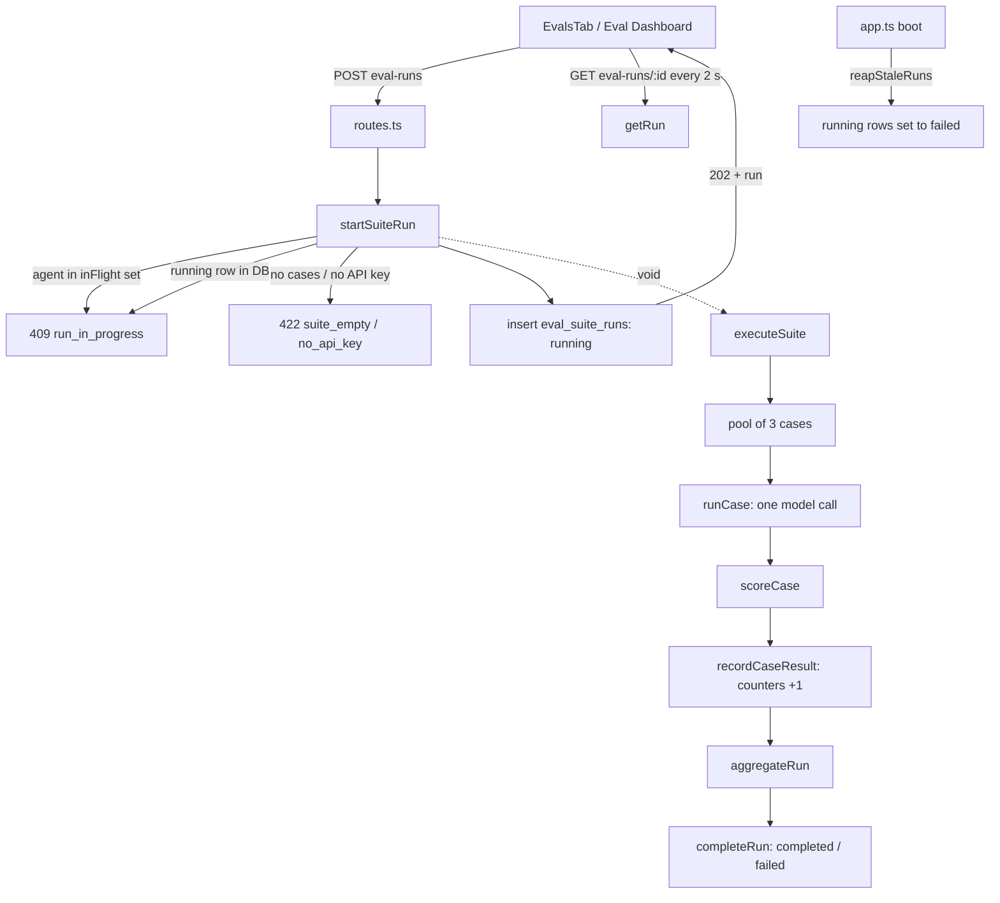

# Eval pipeline — regression suites per agent
<!-- verified against 5f6da15 + working tree on 2026-10-12 · sources: server/src/modules/eval/pipeline-service.ts, server/src/modules/eval/pipeline-scoring.ts, server/src/modules/eval/pipeline-runner.ts, server/src/modules/eval/pipeline-helpers.ts, server/src/modules/eval/routes.ts, server/src/modules/eval/repository/pipeline.repo.ts, server/src/db/schema/eval.ts, server/src/vendor/shared/contracts/eval-pipeline.ts, server/src/app.ts, server/stryker.config.json, scripts/verify-l06.sh, client/src/lib/hooks/eval.ts, client/src/components/eval-case-modal/EvalCaseModal.tsx -->

Read this when you change how a suite case is saved, run or scored, add an eval route, or need to know what a green `pnpm verify:l06` proves. It describes the feature as built by [plan 34](../../docs/plans/34-eval-pipeline.md) (spec [011](../../specs/011-eval-pipeline.md)). To try it with a live model, follow the [manual demo](./eval-pipeline-demo.md).

Diátaxis type: explanation, with the routes and formulas as reference tables inside it.

## What a case and a run are

A **case** (`eval_suite_cases`) belongs to one agent. It freezes three things: a unified diff (`input_diff`), the files that diff touches, and an `expected` list. Each expectation names a file and a line range and is one of two kinds:

| Kind | Meaning | Seeded from |
|---|---|---|
| `must_find` | the agent must report a finding that overlaps these lines | an accepted finding |
| `must_not_flag` | the agent must not report a finding that overlaps these lines | a dismissed finding |

A case also carries its source (`source_finding_id`, `source_pr_id`, both `null` for a hand-written case) and a `last_result` from the latest single-case or draft run. At most one case exists per source finding, and a name is unique within an agent's suite (unique indexes `eval_suite_cases_source_finding_idx` and `eval_suite_cases_agent_name_idx`). A suite holds at most 200 cases and a diff at most 262 144 bytes (`server/src/modules/eval/constants.ts` → `EVAL_MAX_SUITE_CASES`, `EVAL_MAX_DIFF_BYTES`).

A **suite run** (`eval_suite_runs`) is one pass of the agent's *current* version over every case. It records the agent version, provider, model and the enabled skill set (names and versions), so two runs can be compared later. Each case outcome is a row in `eval_case_results`. Deleting a case cascades its result rows; the run keeps its stored metrics.

A case run sends the model only the agent's prompt, model, strategy and enabled skills plus the frozen diff. No repo context, caller data, intent or PR text goes in (`server/src/modules/eval/pipeline-runner.ts` → `runCase`). It goes through the same review engine (`reviewPullRequest` from `reviewer-core`) and the same grounding, so a finding the engine drops counts as `dropped`.

The tables are separate from `eval_cases` / `eval_runs`, which serve the skill and agent evals (`server/src/db/schema/eval.ts`).

## Building a case: draft, then Save

`EvalCaseModal` (`client/src/components/eval-case-modal/EvalCaseModal.tsx`) is one modal for three situations: a draft seeded from a finding, a new hand-written case, and the edit of a saved case. A draft persists nothing until **Save**.

1. **Turn into eval case** (`TurnIntoEvalCase` on a finding card) is enabled only once the finding is accepted or dismissed. A click calls `GET /findings/:id/eval-draft`, which writes nothing.
2. The server answers `kind: 'draft'` (a prefilled name, the finding's file diff, one expectation) or `kind: 'existing'` (the case already saved for that finding, opened in edit mode). It refuses with `finding_undecided` (409), `agent_missing` (409) or `no_diff_text` (422); the client shows the refusal as a toast and opens no modal. The diff is re-derived from the PR's current SHAs, falling back to the stored `pr_files` patch (`server/src/modules/reviews/service.ts` → `findingSource`).
3. In the modal you edit the name, the diff and the expected JSON. **Run case** (after a confirmation that names the model) calls `POST /agents/:id/eval-draft-runs` for an unsaved or edited case, or `POST /eval-cases/:id/runs` for an unchanged saved case. Neither is a suite run.
4. **Save** calls `POST /agents/:id/eval-cases` (new) or `PUT /eval-cases/:id` (edit). Save never runs the model.

Before a case is stored, `validateCase` (`server/src/modules/eval/pipeline-helpers.ts`) refuses a case whose name is empty or taken, whose diff is too large or has no file with a hunk, whose expected JSON is invalid, or whose expectation does not land on a new-side hunk line (`expectation_ungrounded`, using the same `groundFindings` that grounds model findings). The refusal names the element and the reason.

A draft run returns a single-use `run_token`. If you send it with Save and the diff, expectations, agent version and skill set still hash the same (`runTokenHash`), the result is stored as the case's `last_result`. Any edit after the run makes the token useless and the modal marks the shown result stale. Tokens live in memory for one hour and are lost on restart (`EVAL_DRAFT_TOKEN_TTL_MS`).

Saving a second case for a finding that already has one fails with `case_exists` and the existing case id; the modal offers to open it.

## Scoring (code only)

No model judges another model. `server/src/modules/eval/pipeline-scoring.ts` is pure: no clock, no random, no I/O.

**Matching.** A kept finding matches an expectation when the file path is equal and the line ranges intersect (inclusive; an expectation without `end_line` is a single line). `title`, `severity` and `category` on an expectation are display-only (`findingMatches`, `linesIntersect`).

**Per case** (`scoreCase`):

| Field | Definition |
|---|---|
| `must_find_matched` | `must_find` expectations matched by at least one kept finding |
| `noise` | kept findings that match a `must_not_flag` expectation; when the case has no expectations at all, every kept finding |
| `kept` / `dropped` | findings that survived / failed grounding |
| **pass** | `must_find_matched == must_find_total` **and** `noise == 0`, otherwise `failed` |

A case whose model call or parse throws is `errored` with a one-line redacted reason, and is excluded from the metrics.

**Per run** (`aggregateRun`), summed over the non-errored cases:

| Metric | Formula | `null` when |
|---|---|---|
| `recall` | Σ must_find_matched / Σ must_find_total | no `must_find` expectations |
| `precision` | 1 − Σ noise / Σ kept | no finding was kept |
| `citation_accuracy` | Σ kept / (Σ kept + Σ dropped) | no finding was produced |
| `cases_passed` | count of `passed` cases | — |

A zero denominator gives `null` ("no data"), never `0`. A run whose every case errored is `failed` with all three metrics `null`.

**Comparison.** `metricDeltas` is the latest completed run minus the previous one (`null` if either side is `null`). `regressionAlert` fires when any metric fell by at least one whole percentage point (`Math.round(Δ × 100) < 0`); it lists the dropped and the risen metrics.

## Run lifecycle

The diagram shows one suite run from click to terminal status. The dashed edge is the fire-and-forget step; everything under it runs after the HTTP response.

- **Background.** `POST /agents/:id/eval-runs` returns `202` with the `running` run at once. `executeSuite` runs the cases three at a time (`EVAL_CASE_CONCURRENCY`) with a 240 s deadline per model call (`EVAL_CASE_CALL_DEADLINE_MS`). After each case, `recordCaseResult` stores the result and bumps `cases_done`, `cases_passed` and `cases_errored` in one transaction. If the executor itself throws, the run is closed `failed` so it never stays `running`.
- **Polling.** The client polls `GET /eval-runs/:id` every 2 s while `status` is `running` and stops on a terminal status (`client/src/lib/hooks/eval.ts` → `useEvalRun`). The Evals tab also picks up a run that is still `running` after a reload.
- **In-flight guard.** `startSuiteRun` adds the agent id to an in-memory set *before its first `await`*, so two simultaneous requests cannot both pass. A DB check (`hasRunning`) covers a run started by another writer. The set entry is removed when the run finishes or when start fails. A second start gets `409 run_in_progress`.
- **Key check first.** The provider client is resolved before the run row is created. A missing key refuses the start with `422 no_api_key`, and no run is created.
- **Boot reap.** On boot, before the server accepts requests, `app.ts` calls `container.evalPipeline.reapStaleRuns()`, which marks every `running` suite run `failed`. This assumes one API instance per database, like the existing `agent_runs` reaper. A reaping error is logged and does not stop the boot.
- **Run all.** `POST /eval/run-all` starts one suite run per enabled agent that has cases and skips, by name, any agent with a run in progress or no API key. It requires the JSON body `{ "confirm": true }`, so a cross-origin form or `text/plain` POST cannot trigger paid calls.
- **Promote.** `POST /eval-runs/:id/promote` brings the run's agent config and the skills it recorded back as a new agent version. Skills that no longer exist are left out (`pipeline-service.ts` → `promote`).

## Routes

All routes are workspace-scoped and live in `server/src/modules/eval/routes.ts`. Rows marked *paid* call a model and share a rate limit of 10 per minute (`RATE_LIMIT`). Refusals are `AppError`s from the service.

| Route | Returns | Notes |
|---|---|---|
| `GET /agents/:id/eval-cases` | `EvalSuiteCase[]` | |
| `POST /agents/:id/eval-cases` | `201 EvalSuiteCase` | Save; optional `source_finding_id`, `draft_run_token` |
| `PUT /eval-cases/:id` | `EvalSuiteCase` | clears the case's `last_result` |
| `DELETE /eval-cases/:id` | `204` | |
| `POST /eval-cases/:id/runs` | `EvalSuiteCase` | *paid*; one saved case, stores `last_result` |
| `GET /findings/:id/eval-draft` | `EvalDraftSeed` | writes nothing |
| `POST /agents/:id/eval-draft-runs` | `EvalDraftRunResult` | *paid*; persists nothing, returns `run_token` |
| `POST /agents/:id/eval-runs` | `202 EvalSuiteRun` | *paid*; background suite run |
| `GET /agents/:id/eval?period=` | `EvalAgentDetail` | `30d` (default) or all; runs, trend, deltas, alert |
| `GET /eval-runs/:id` | `EvalSuiteRunDetail` | run plus per-case results; the polling target |
| `GET /eval-runs/compare?a=&b=` | `EvalCompare` | two different runs of one agent, else `422 runs_not_comparable` |
| `POST /eval-runs/:id/promote` | `EvalPromoteResult` | rate-limited; writes a new agent version |
| `GET /eval/dashboard` | `EvalDashboardView` | every agent, latest metrics, sparkline, recent runs |
| `GET /eval/run-all` | `EvalRunAllPreview` | agents that would run, and those skipped |
| `POST /eval/run-all` | `EvalRunAllResult` | *paid*; body `{ confirm: true }` |

The contract is `server/src/vendor/shared/contracts/eval-pipeline.ts`; the client copy `client/src/vendor/shared/contracts/eval-pipeline.ts` must stay byte-identical (`verify:l06` checks it).

## Where it shows in the studio

| Place | Path |
|---|---|
| Turn into eval case button | `client/src/app/repos/[repoId]/pulls/[number]/_components/TurnIntoEvalCase/` |
| Case modal | `client/src/components/eval-case-modal/` |
| Agent > Evals tab (cases, run all, active run) | `client/src/app/agents/[id]/_components/AgentEditor/_components/EvalsTab/` |
| Eval Dashboard (`/eval`) | `client/src/app/eval/` |
| Agent history, trend, compare, promote (`/eval/:agentId`) | `client/src/app/eval/[agentId]/` |

The Eval Dashboard nav item is a hand edit of the vendored `client/src/vendor/ui/nav.ts`; a vendor refresh drops it.

## Next to the plan-09 fixture CLI

The planted-issue tool from plan 09 (`pnpm eval:review`, `server/src/modules/eval/cli.ts`, with `eval:replay`) is unchanged. It scores *stored review runs* of one fixture PR and writes `eval_cases` / `eval_runs`. The pipeline above has its own tables, service, repository and routes, and shares only the module folder and `describeJobError` from `server/src/modules/eval/replay.ts`. Neither feature reads the other's rows.

## Checking it

**`pnpm verify:l06`** (from `server/`, runs `scripts/verify-l06.sh`) is hermetic: provider keys are unset, `HOME` is a temp directory, and the server tests use scripted mock providers, so no model is called. It stops at the first failure:

1. `vitest run test/eval-pipeline` in `server/` (unit, the fixture suite of 8 cases, and `.it` tests that need Docker).
2. `pnpm typecheck` in `client/`.
3. `pnpm test` in `client/`.
4. `cmp` of the server and client `eval-pipeline.ts` contract copies.

**Mutation testing** covers the scoring module only. `pnpm mutation:eval-scoring` runs Stryker (`server/stryker.config.json`) on `src/modules/eval/pipeline-scoring.ts`, in place, against `test/eval-pipeline-scoring.test.ts` only (`server/vitest.mutation.config.ts` replaces the base `include`). It takes about five minutes and writes `server/reports/mutation/mutation.html` and `.json`, which are gitignored. Last committed result: 179 mutants, 173 killed, 6 survived, all equivalent (score 96.65 %, 100 % excluding equivalents). The survivors and why none can be killed are in the [mutation report](../../docs/plans/assets/34-eval-pipeline/mutation-report.md). A survivor outside that list is a real test gap.

## Rationale

- Scoring is a pure function module inside the server eval module (decision D4-A, [the plan](../../docs/plans/34-eval-pipeline.md)); the spec requires code-only scoring ([spec 011](../../specs/011-eval-pipeline.md), *Scoring (code only)*). It is not model-judged because every expectation is a concrete `file` + line range, so a match is decidable by code: file equality plus range intersection. A judge model is needed only when "the answer explains the cause" has to be read from prose, as in the harness evals under `evals/`. Code scoring is free, deterministic and repeatable, so two runs of different agent versions are compared on the same yardstick, and `verify:l06` can prove that scoring makes zero LLM calls.
- The ≥ 8-case suite on Security Reviewer is not seeded: a fixture serves tests and `verify:l06`, and the user builds the real suite from their own accept/dismiss decisions (plan GAP2).
